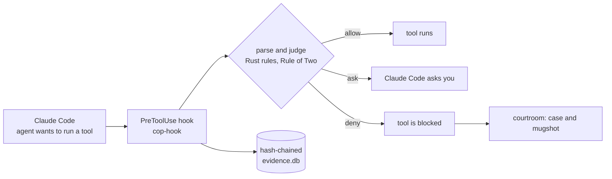

<p align="center">
  
</p>

<h1 align="center">AgentCop</h1>

<p align="center">
  <b>A cartoon cop for your AI coding agent: it stops dangerous actions before they run, and keeps tamper-evident evidence of everything.</b>
</p>

<p align="center">
  <a href="LICENSE-MIT"></a>
  
  
</p>

<!-- TODO: record docs/assets/arrest.gif with VHS (docs/assets/tapes/arrest.tape). Not recorded yet. -->
> **GIF coming:** the arrest moment (`docs/assets/arrest.gif`) is not recorded yet. It will be a hook replay, not a live Claude Code session.

> **Status: pre-release (v0.1 candidate).** Claude Code only, Linux only, command-line hook. It is a seatbelt, not a force field. Read [what AgentCop does not catch](WHAT-AGENTCOP-DOES-NOT-CATCH.md) before you rely on it. AgentCop is an unofficial hobby project with no connection to any police force.

## Why

In April 2026, a Cursor AI agent working on PocketOS, a car rental software company, deleted the production database and its volume-level backups in a single API call that took nine seconds. The newest off-site backup was about three months old ([Giskard write-up](https://www.giskard.ai/knowledge/a-cursor-ai-agent-wiped-a-production-database-in-9-seconds-excessive-agency-ai-failure)).

Coding agents run commands with your permissions. A rule written in a prompt is a request. AgentCop is a check that runs before every tool call, and it decides in code.

## How it works



The judge is deterministic Rust. No language model is on the allow or deny path. The detective is a separate, offline Python reader. It has no tools, and it can only raise a case's severity. It can never release anyone.

## What happens when it catches something

| Verdict | Sound today | What the agent and you see |
| --- | --- | --- |
| allow | none | nothing; the call runs |
| ask | none | Claude Code asks you to confirm, with the reason and a case number |
| deny | none | `Destructive remove on root or home [CASE-0123456789ab]` (example) |
| honeytoken touched | none | `Honeytoken triggered: suspect took the bait [CASE-…]` (example) |
| courtroom decision | synthesized gavel (courtroom only) | the decision appears in the timeline |

The command-line hook is silent in this build. Its sound clips are not shipped, so it has nothing to play.

## Quick start

Requires Rust (stable). Linux only.

```bash
git clone <this repo> agentcop && cd agentcop
cargo build --release -p cop-cli -p cop-hook

./target/release/agentcop install --dry-run   # show what would change, change nothing
./target/release/agentcop install             # back up settings.json, add the hook
./target/release/agentcop doctor              # health check, one line per check
```

Example `doctor` output on a fresh install, after one session start (paths shortened):

```
agentcop doctor (CLI 0.0.1)
PASS  folder and file modes: ~/.agentcop 0700, files 0600
PASS  hook path: $HOME/.claude/settings.json runs $HOME/.agentcop/bin/cop-hook
PASS  installed hook is cop-hook 0.0.1
PASS  policy canaries: every must-catch action is caught
PASS  evidence chain verifies (2 rows)
PASS  last session start (heartbeat): 2026-10-26T20:04:38.656582617-06:00
PASS  mode: enforce (denials are enforced)
PASS  no raw-data archives on disk
Summary: 8 pass, 0 warn, 0 fail.
```

**Start in log-only mode** for a trial week. Log-only allows every call and records what would have been blocked. Edit `~/.agentcop/policy.toml` and set:

```toml
mode = "log-only"
```

Then, day to day:

```bash
./target/release/agentcop doctor                       # today's health; log-only shows one WARN
./target/release/agentcop cases --today --would-block  # what enforce mode would have stopped today
./target/release/agentcop cases show CASE-0123456789ab # one case in full (example ID)
./target/release/agentcop verify                       # check the evidence hash chain
```

When the trial is done, set `mode = "enforce"`. To remove AgentCop:

```bash
./target/release/agentcop uninstall   # removes our two hook entries; settings become byte-identical to the backup
```

Evidence stays after uninstall. `agentcop uninstall --purge` deletes it, after asking.

Other commands: `agentcop cases` (list), `agentcop fix CASE-<id>` (suggest a deny rule, shows the diff, asks before writing), `agentcop release <session>` (end a Rule of Two freeze, logged).

## Locked out? Emergency steps

If AgentCop refuses every tool call, the reason on screen names the fix. For example, a group-writable state folder gives:

```
Error: $HOME/.agentcop is group- or world-writable (mode 770); refusing to run (fail closed). Fix it: run: chmod 700 $HOME/.agentcop
```

If the refusal blocks you, do this from a normal terminal, outside Claude Code:

1. Remove the hook: restore the backup with `cp ~/.claude/settings.json.bak ~/.claude/settings.json`, or delete the `hooks.PreToolUse` entry whose `command` contains `cop-hook`.
2. Restart Claude Code. Nothing is enforced while the hook is gone.
3. Fix the modes the refusal named, for example `chmod 700 ~/.agentcop` and `chmod 600 ~/.agentcop/*.db ~/.agentcop/hmac.key ~/.agentcop/policy.toml`.
4. Run `./target/release/agentcop install` again. It copies the hook to `~/.agentcop/bin` and tightens the modes.

An old evidence store that holds raw commands is moved aside on the next run, to `~/.agentcop/evidence-legacy.db`. Nothing is deleted. `agentcop evidence purge-legacy` deletes archives, after asking.

## What it does NOT catch

- **Other agents and other platforms.** Claude Code only. Codex has a parser as library code, but nothing installs it. Only Linux has been tested.
- **Anything the patterns did not anticipate.** Every rule is a regular expression on a command's steps. A new trick can pass.
- **Indirect commands.** A script is read when a command runs it, but a script changed after that read is not checked again. Scripts run by `npm run`, `make` or `python x.py` are not read.
- **HTTPS contents.** The egress proxy checks host names of HTTPS tunnels only, and it is not yet in the agent's path.
- **Live kernel monitoring.** The eBPF and syscall sensors are library code tested with fixtures. Nothing loads a kernel probe.
- **Process freezing.** The holding cell can freeze processes, but no running component calls it. A freeze blocks tool calls only.
- **A trusted owner.** Anyone with root can change the hook, the policy or the evidence file. The evidence chain shows edits, not who made them.

Full list, with the tests behind each: [what AgentCop does not catch](WHAT-AGENTCOP-DOES-NOT-CATCH.md).

## AgentCop arrested its own builder

I built AgentCop with Claude Code, and it was arrested more than once. The full story is in [BUILD-STORY.md](BUILD-STORY.md). The best highlights:

- **The first "26 of 26 phases" was false.** Only 18 were done, and the hook's output format was wrong, so Claude Code would have ignored every decision. Tests now run the real binary.
- **Read-only checks were denied as "disabling the cop".** A rule matched any mention of the cop's name. It now denies writes only.
- **A grep for `\.env(` set the secret flag.** Secret files are now matched by file name from the parsed command, not by text.
- **My own umask locked me out.** A group-writable state folder made the hook refuse every tool call. The refusal now names the fix.
- **One quoting edit let `rm -rf /` through.** The policy canaries now catch it, and install refuses a policy that allows any of them.

## Status and roadmap

- **Now:** v0.1 candidate. Claude Code hook, command-line tool, evidence store, Rule of Two, log-only mode, courtroom dashboard (local, on 127.0.0.1).
- **Log-only trial week:** starts Tuesday 27 October 2026.
- **Next:** Codex install path; egress proxy in the agent's path; live eBPF sensors; the courtroom releasing and thawing sessions.
- **Planned, not built:** "Escape the Cop", a game idea. There is no design yet.

## Contributing

Issues and pull requests are welcome. Run `./scripts/check.sh` before you send a change. It runs format, clippy (warnings are errors), all Rust tests, the Python detective tests, the courtroom checks and the attack suite.

## Testing and layout

```bash
./scripts/check.sh
```

| Path | What it is |
| --- | --- |
| `crates/cop-hook` | The hook binary Claude Code calls for every tool use |
| `crates/cop-cli` | `agentcop`: install, uninstall, doctor, cases, fix, verify, release |
| `crates/cop-policy` | Policy loading, rules, canaries, mode |
| `crates/cop-shell` | Parses shell commands into the steps they would run; secret file names |
| `crates/cop-taint` | Rule of Two |
| `crates/cop-evidence` | Hash-chained SQLite evidence store |
| `detective/` | Offline Python reader (can only raise severity) |
| `courtroom/` | Local dashboard (TypeScript, React, Node) |
| `tests/attacks/` | Attack corpus and runner |
| `policy/` | Rule files: `default.toml`, `taint.toml`, `egress.toml` |

## FAQ

**Is this a real police thing?** No. It is a cartoon for a developer tool. It arrests nobody and has no badge.

**Will it stop every bad command?** No. It stops what its rules match. See [what it does not catch](WHAT-AGENTCOP-DOES-NOT-CATCH.md).

**Can I try it without blocking anything?** Yes. Set `mode = "log-only"` in `~/.agentcop/policy.toml`. Every call is allowed, and the would-be blocks are recorded for review.

**Why case numbers?** So you can ask "why was that blocked?" and get a record. `agentcop cases show` prints one.

## Docs

- [THREAT_MODEL.md](THREAT_MODEL.md): what AgentCop defends against, and what it does not.
- [WHAT-AGENTCOP-DOES-NOT-CATCH.md](WHAT-AGENTCOP-DOES-NOT-CATCH.md): the known misses.
- [BUILD-STORY.md](BUILD-STORY.md): how it was built, and how it arrested its builder.
- [CHANGELOG.md](CHANGELOG.md)

## License

Dual licensed under [MIT](LICENSE-MIT) or [Apache-2.0](LICENSE-APACHE), at your option.

## Security

See [SECURITY.md](SECURITY.md) to report a problem privately.
