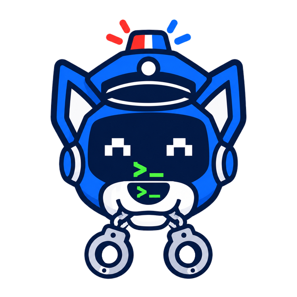
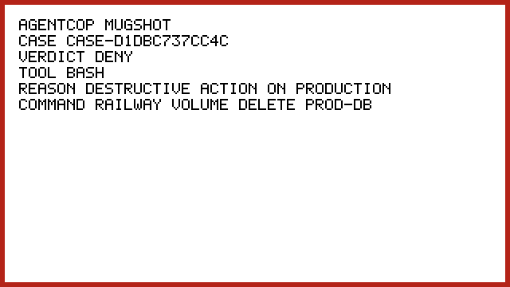
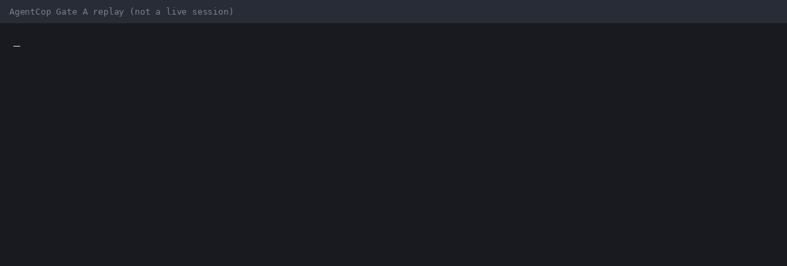
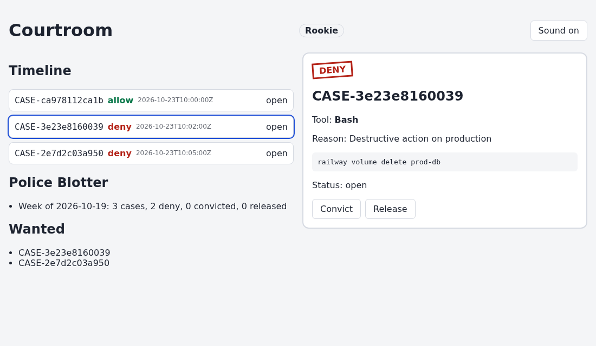

# AgentCop

<p align="center">
  
</p>

<p align="center">
  
</p>

**AgentCop is a cartoon police officer for AI coding agents.** It stands between the agent and your computer. When the agent tries something dangerous, AgentCop stops it, writes it down, and gives the case a number.

> **Status: pre-release (v0.1 candidate).** Claude Code only, Linux first. It is a seatbelt, not a force field. The rules are only as good as their patterns, and some things get past them. Read [what AgentCop does not catch](WHAT-AGENTCOP-DOES-NOT-CATCH.md) before you rely on it.
>
> AgentCop is an unofficial hobby project. It has no connection to any police force, and it does not impersonate one. The sirens are optional, and there is a mute button.

## See it work



*A replay, not a live recording. It sends the same event Claude Code sends and shows the block. This GIF is silent, because GIFs cannot carry sound. A version with the siren comes from a live recording.*



*The courtroom runs on your own machine, on 127.0.0.1, with a random token. The data above is made up.*

## What it does

- **Judge.** Rules in `policy/default.toml` (regex, strictest verdict wins). Blocks destructive removes of root or home, production deletes, secret-file reads, piping downloads into a shell, and attempts to stop or edit the cop. Asks before `git push`.
- **Evidence.** Every decision goes into a SQLite store (`~/.agentcop/evidence.db`). Each row is hash-chained to the one before it, and `agentcop verify` checks the chain.
- **Case numbers.** Every verdict ends with `[CASE-xxxxxxxxxxxx]`. `agentcop fix` turns a case into a deny rule you review before it is written.
- **Rule of Two.** A session that reads untrusted input, touches sensitive data, and takes an external action is frozen for the rest of that session.
- **Log-only mode.** `mode = "log-only"` allows every call and records what would have been blocked. Use it to measure false positives before you enforce.
- **Courtroom.** A local dashboard (`courtroom/`) that lists cases, shows a redacted mugshot card and PNG, and records release or convict decisions.
- **Detective.** An offline Python reader (`detective/`) that can only raise a case's severity. Its output is schema-checked. It has no tools.

## Quick start

Requires Rust (stable), and for the full check also Python 3.11+ with `pydantic` and `pytest`, and Node 20+ for the courtroom.

```bash
git clone <this repo> agentcop && cd agentcop
cargo build --release -p cop-cli -p cop-hook

./target/release/agentcop install --dry-run   # show what would change
./target/release/agentcop install             # add the hook (backs up settings.json first)
```

The hook records the path of the `cop-hook` binary it was installed from. Keep the build folder in place, or run `install` again after moving it.

Day to day:

```bash
./target/release/agentcop cases               # list cases: CASE-id, verdict, time, reason
./target/release/agentcop fix CASE-<id>       # suggest a deny rule for one case, asks before writing
./target/release/agentcop verify              # check the evidence hash chain
./target/release/agentcop uninstall           # restore settings.json from the backup
```

Log-only mode, for a trial week: copy `policy/default.toml` to `~/.agentcop/policy.toml`, set `mode = "log-only"`, then `install`. The steps above are the whole procedure.

Courtroom:

```bash
cd courtroom && npm install && npm start      # prints a local URL with a random token
```

## Testing

```bash
./scripts/check.sh
```

This runs format, clippy (warnings are errors), all Rust tests, the Python detective tests, the courtroom typecheck, build and Playwright tests, and the attack suite. Each run writes its results to a local report.

## Layout

| Path | What it is |
| --- | --- |
| `crates/cop-hook` | The hook binary Claude Code calls for every tool use |
| `crates/cop-cli` | `agentcop` CLI: install, uninstall, cases, fix, verify |
| `crates/cop-policy` | Policy loading, rule matching, mode |
| `crates/cop-evidence` | Hash-chained SQLite evidence store |
| `crates/cop-taint` | Rule of Two |
| `crates/cop-proxy` | Egress proxy: domain allowlist and secret scan on plaintext HTTP |
| `crates/cop-cell` | Holding cell: cgroup freeze with SIGSTOP fallback |
| `crates/cop-bundle` | Case bundle for the detective, with untrusted text quoted and capped |
| `detective/` | Python detective (raise-only severity) |
| `courtroom/` | Local dashboard (TypeScript, React, Node) |
| `tests/attacks/` | Attack corpus and runner |
| `policy/` | Rule files: `default.toml`, `taint.toml`, `egress.toml` |

## Docs

- [THREAT_MODEL.md](THREAT_MODEL.md): what AgentCop defends against, and what it does not.
- [CHANGELOG.md](CHANGELOG.md)
- [WHAT-AGENTCOP-DOES-NOT-CATCH.md](WHAT-AGENTCOP-DOES-NOT-CATCH.md)

## FAQ

**Is this a real police thing?** No. It is a cartoon for a developer tool. It does not arrest anyone, and it has no badge.

**Will it stop every bad command?** No. It stops the ones its rules match. See [what AgentCop does not catch](WHAT-AGENTCOP-DOES-NOT-CATCH.md).

**Can I turn off the sirens?** Yes. The courtroom has a Sound on/off button, and the sound pack can be left out.

**Can I try it without blocking anything?** Yes. Set `mode = "log-only"` in the policy. Every call is allowed, and the would-be blocks are recorded for review.

**Why case numbers?** So you can ask "why was that blocked?" and get a record. `agentcop cases` and `agentcop fix` use them.

## License

Dual licensed under [MIT](LICENSE-MIT) or [Apache-2.0](LICENSE-APACHE), at your option.

## Security

See [SECURITY.md](SECURITY.md) to report a problem privately.
